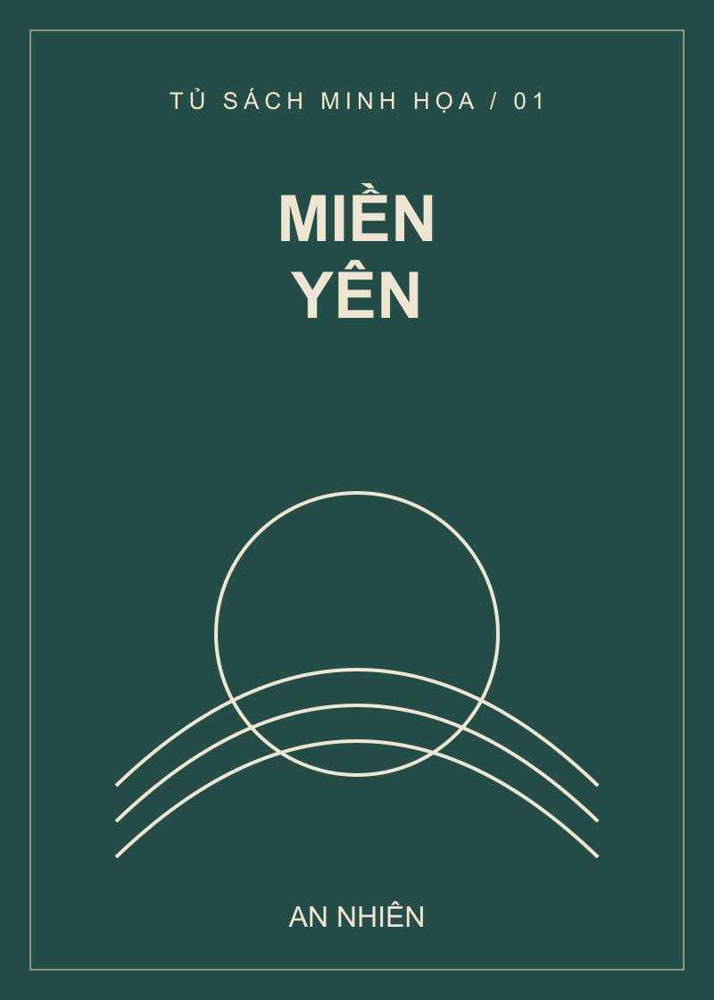

# E-commerce UI Improvement

**Dự án:** Góc sách – Cải tiến giao diện thẻ sản phẩm sách  
**Môn học:** Phát triển ứng dụng WEB/TMĐT  
**Giảng viên:** TS Nguyễn Mạnh Tuấn – tuannm@ueh.edu.vn  
**Mã nguồn:** [ecommerce-ui-improvement](https://github.com/huytran31241023748-code/ecommerce-ui-improvement)  
**Website:** [Góc sách trên GitHub Pages](https://huytran31241023748-code.github.io/ecommerce-ui-improvement/)

## 1. Giới thiệu

Dự án thực hành cải tiến giao diện dựa trên khảo sát website thương mại điện tử **Fahasa**. Khu vực được lựa chọn là **thẻ sản phẩm trong danh sách sách**, với ba mục tiêu:

- Hiển thị đầy đủ tên sách để người dùng nhận diện sản phẩm.
- Phân biệt rõ giá bán, giá gốc và mức giảm để dễ so sánh.
- Bố trí liên kết thao tác rõ ràng, nhất quán giữa các thẻ.

Sản phẩm là một trang **HTML5/CSS3** mang tên **Góc sách**, có bốn sách mẫu và bố cục thích ứng với máy tính, máy tính bảng, điện thoại. Phương án được chọn là **thẻ dọc dạng lưới**.

Trang sử dụng bốn sách mẫu có độ dài tên và cách hiển thị giá khác nhau để thể hiện kết quả cải tiến giao diện.

### 1.1. Bối cảnh thực hiện

Trong quá trình duyệt sách trực tuyến, khách hàng thường cần nhận diện ảnh bìa, đọc tên, kiểm tra giá và chuyển sang xem thông tin chi tiết. Một thẻ sản phẩm vì vậy phải cung cấp đủ thông tin cho bước lựa chọn ban đầu, đồng thời giữ bố cục dễ quan sát khi đặt cạnh nhiều sản phẩm khác.

Từ khảo sát Fahasa, dự án lựa chọn cải tiến một thành phần có phạm vi cụ thể thay vì xây dựng toàn bộ website bán hàng. Thẻ sách được sử dụng làm đơn vị thiết kế chính; cùng một cấu trúc được áp dụng cho cả sách tên ngắn, tên dài, có giảm giá và không có giảm giá.

### 1.2. Mục tiêu và tiêu chí thiết kế

| Mục tiêu | Cách thể hiện trong sản phẩm | Tiêu chí đánh giá |
| --- | --- | --- |
| Nhận diện sách | Ảnh bìa, tên đầy đủ, tác giả và thể loại được sắp xếp theo thứ tự. | Đọc được tên mà không cần rê chuột để xem phần bị ẩn. |
| So sánh giá | Giá bán nổi bật; giá gốc và mức giảm nằm trong nhóm thông tin phụ. | Phân biệt ngay mức giá hiện tại và giá trước giảm. |
| Thao tác rõ ràng | Mỗi thẻ có một liên kết chính ở cuối thẻ. | Biết bước tiếp theo là xem thông tin chi tiết. |
| Nhất quán | Dùng chung mẫu thẻ, khung ảnh, kiểu chữ và vị trí thao tác. | Nội dung dài ngắn khác nhau vẫn giữ bố cục có trật tự. |
| Thích ứng màn hình | Điều chỉnh số cột bằng Media Queries. | Không tràn ngang tại các chiều rộng đã kiểm tra. |

### 1.3. Phạm vi sản phẩm

Trang bao gồm phần nhận diện **Góc sách**, tiêu đề **Khám phá sách hay**, danh sách **Sách nổi bật**, khu vực **Đọc thêm một chút** và chân trang. Nội dung tập trung vào việc duyệt, so sánh và đọc thông tin sách. Các bước xử lý đơn hàng nằm ngoài phạm vi triển khai.

Luồng sử dụng chính:

```text
Mở trang → Duyệt bốn sách → Đọc tên và so sánh giá
         → Chọn Xem chi tiết → Đọc giới thiệu → Quay lại danh sách
```

## 2. Website tham khảo

- **Tên website:** FAHASA – Nhà Sách Trực Tuyến Việt Nam.
- **URL:** https://www.fahasa.com/
- **Trang danh mục tham khảo:** https://www.fahasa.com/sach-trong-nuoc.html
- **Nhóm sản phẩm:** Sách trong nước, sách ngoại văn, văn phòng phẩm, dụng cụ học tập, đồ chơi và sản phẩm giáo dục.
- **Khách hàng mục tiêu dự kiến:** Học sinh, sinh viên, phụ huynh, giáo viên, người yêu sách và người mua dụng cụ học tập; được nhận định từ các nhóm hàng quan sát được.
- **Khu vực đã khảo sát:** Trang chủ, danh mục sản phẩm, chi tiết sản phẩm, tìm kiếm và giỏ hàng.

### Tóm tắt kết quả khảo sát

| Khu vực | Nội dung ghi nhận | Cơ hội cải tiến |
| --- | --- | --- |
| Trang chủ | Có banner, Flash Sale, danh mục và các khối giới thiệu sản phẩm; nhiều nội dung quảng bá nổi bật. | Điều chỉnh mức độ nổi bật của banner phụ để giảm cạnh tranh sự chú ý. |
| Danh mục sản phẩm | Có menu phân cấp và các nhóm lọc; một số nhãn dài bị rút gọn. | Hiển thị nhãn rõ hơn và ưu tiên tiêu chí theo nhóm hàng. |
| Chi tiết sản phẩm | Có hình ảnh, giá, mô tả, thông tin sách và nút mua; một số nhãn ưu đãi bị rút gọn trong ảnh khảo sát. | Tóm tắt mức giảm và điều kiện chính để dễ đánh giá ưu đãi. |
| Tìm kiếm | Ảnh khảo sát cho thấy gợi ý từ khóa và sản phẩm; một số tên dài bị cắt ngắn. | Bổ sung không gian cho tên và thông tin giúp phân biệt sản phẩm. |
| Giỏ hàng | Có sản phẩm, số lượng và tổng tiền; trong khung xem hẹp đã kiểm tra, các khối ưu đãi đứng trước danh sách hàng. | Ưu tiên phần rà soát sản phẩm trên màn hình hẹp. |

**Cơ sở chọn cải tiến:** Một số tên sản phẩm dài trong ảnh Flash Sale bị rút gọn bằng dấu ba chấm. Điều này có thể che thông tin nhận diện sách hoặc phiên bản. Dự án tập trung giải quyết khả năng đọc tên, đồng thời giữ cách phân biệt giá đang hữu ích.

**Phạm vi khảo sát:** Giao diện và một số thao tác mua sắm trước thanh toán. Bộ lọc, sắp xếp, xử lý kết quả tìm kiếm, cập nhật số lượng, xóa hàng và giỏ trống chưa được kiểm chứng đầy đủ.

### Phân tích theo yêu cầu khảo sát

| Khu vực | Chức năng được ghi nhận | Điểm hợp lý | Điểm có thể cải thiện | Đề xuất và lý do |
| --- | --- | --- | --- | --- |
| Trang chủ | Giới thiệu nhóm hàng, banner, Flash Sale, sản phẩm và lối truy cập tìm kiếm, giỏ hàng. | Nội dung chia thành khối; giá bán và giá gốc có cách thể hiện khác nhau. | Nhiều banner có màu nổi có thể cạnh tranh sự chú ý. | Giảm mức độ nổi bật của banner phụ, giúp khách tập trung vào điều hướng và sản phẩm. |
| Danh mục | Menu nhóm hàng, nhóm con, bộ lọc và nhãn sắp xếp. | Phân cấp hỗ trợ đi từ nhóm tổng quát đến nhu cầu cụ thể. | Nhãn dài bị rút gọn; nhiều tiêu chí có thể làm người dùng mới mất công lựa chọn. | Hiển thị nhãn rõ, ưu tiên bộ lọc theo nhóm hàng để giảm công sức thu hẹp danh sách. |
| Chi tiết | Ảnh, giá, mô tả, thông số, số lượng và nút mua. | Hình ảnh và giá dễ nhận biết; thông tin sách hỗ trợ đánh giá trước mua. | Một số nhãn ưu đãi trong ảnh sản phẩm robot Pika bị rút gọn. | Đưa mức giảm và điều kiện chính vào phần tóm tắt để hỗ trợ quyết định. |
| Tìm kiếm | Ô tìm kiếm đầu trang, gợi ý từ khóa và sản phẩm trong ảnh khảo sát. | Gợi ý có ảnh giúp nhận diện sản phẩm trước khi mở chi tiết. | Tên dài trong gợi ý bị cắt; chưa thấy giá trong bảng gợi ý đã chụp. | Tăng không gian tên, bổ sung giá hoặc thuộc tính phân biệt để lựa chọn thuận tiện hơn. |
| Giỏ hàng | Danh sách hàng, giá, số lượng, lựa chọn sản phẩm và tổng tiền. | Tách vùng hàng và tổng kết trên ảnh máy tính; giá trị tổng thay đổi theo trạng thái chọn trong tình huống đã thử. | Nhiều khối ưu đãi đứng trước danh sách hàng trong khung xem hẹp. | Ưu tiên danh sách hàng và thu gọn ưu đãi để khách rà soát nhanh. |

Các tác động như phân tán sự chú ý hoặc tăng công sức lựa chọn là nhận định từ bố cục quan sát được, chưa phải số liệu đo hành vi khách hàng.

### Lý do lựa chọn thẻ sản phẩm

Thẻ sản phẩm xuất hiện ở bước khách hàng đang cân nhắc nhiều lựa chọn, nên cách trình bày tên, ảnh và giá có quan hệ trực tiếp với nhiệm vụ so sánh. Phạm vi này cũng phù hợp với HTML/CSS: có thể cải thiện rõ cấu trúc thông tin, bố cục và trạng thái tương tác mà không cần bổ sung hệ thống xử lý đơn hàng.

Phương án giữ lại cách làm hữu ích từ website tham khảo, gồm ảnh bìa để nhận diện, giá bán nổi bật và giá gốc gạch ngang. Các thay đổi tập trung vào tên đầy đủ, cách căn thông tin và một liên kết chính nhất quán.

## 3. Chức năng

- Hiển thị danh sách bốn sách mẫu, có tên ngắn và tên dài.
- Mỗi thẻ có ảnh bìa, thể loại, tên sách, tác giả, giá bán và liên kết **Xem chi tiết**.
- Hiển thị giá gốc gạch ngang và nhãn giảm giá khi có dữ liệu tương ứng.
- Sản phẩm không giảm giá chỉ hiển thị giá bán.
- Liên kết **Xem chi tiết** dẫn tới phần giới thiệu sách tương ứng trong cùng trang.
- Có liên kết quay lại danh sách, liên kết bỏ qua phần đầu trang và viền tiêu điểm khi sử dụng bàn phím.
- Bố cục hỗ trợ nhiều kích thước màn hình:

| Chiều rộng màn hình | Số cột sản phẩm |
| --- | ---: |
| Từ 1100px | 4 |
| Từ 600px đến dưới 1100px | 2 |
| Dưới 600px | 1 |

### Dữ liệu mẫu

| Tên sách | Tác giả | Giá bán | Giá gốc | Giảm giá |
| --- | --- | ---: | ---: | ---: |
| Miền yên | An Nhiên | 80.000 đ | 100.000 đ | 20% |
| Khu vườn nhỏ giữa những ngày bận rộn | Minh Hà | 125.000 đ | — | — |
| Đi qua những vì sao — Hành trình khám phá bầu trời đêm | Hải Đăng | 150.000 đ | 200.000 đ | 25% |
| Sổ tay sáng tạo mỗi ngày | Thanh Mai | 135.000 đ | 150.000 đ | 10% |

Dự án tập trung vào giao diện danh sách và thông tin sách trong cùng trang.

### Cấu trúc một thẻ sách

| Thứ tự | Thành phần | Vai trò đối với người xem |
| --- | --- | --- |
| 1 | Bìa sách | Tạo dấu hiệu nhận diện bằng hình ảnh. |
| 2 | Thể loại | Cung cấp bối cảnh nội dung ngắn gọn. |
| 3 | Tên sách | Xác định sản phẩm; hiển thị đầy đủ khi tên dài. |
| 4 | Tác giả | Bổ sung thông tin nhận diện. |
| 5 | Giá bán hiện tại | Cung cấp mức giá dùng để so sánh. |
| 6 | Giá gốc và nhãn giảm, nếu có | Thể hiện chênh lệch giá mà không lấn át giá bán. |
| 7 | Xem chi tiết | Điều hướng đến nội dung giới thiệu tương ứng. |

### Nguyên tắc hiển thị giá

Giá dùng dấu chấm phân tách hàng nghìn và ký hiệu `đ`, thống nhất giữa các sản phẩm. Giá bán hiện tại có cỡ chữ lớn hơn giá gốc. Với sách không giảm giá, thẻ vẫn giữ vùng thông tin giá cân đối nhưng không tạo giá gốc hoặc nhãn giảm trống.

Công thức đối chiếu phần trăm giảm:

```text
Tỷ lệ giảm (%) = (Giá gốc − Giá bán) / Giá gốc × 100
```

Ví dụ trong bộ dữ liệu mẫu, **Miền yên** có giá gốc **100.000 đ**, giá bán **80.000 đ**, tương ứng giảm **20%**. Các con số được ghi trực tiếp trong HTML; trang không tự tính hoặc tự cập nhật giá.

### Điều hướng và phản hồi tương tác

**Xem chi tiết** là liên kết được định dạng thành nút. Khi kích hoạt, trình duyệt chuyển đến phần giới thiệu cùng cuốn sách trên trang. Phần đích đổi đường viền nhờ `:target`, giúp nhận biết nội dung vừa được mở.

Mỗi liên kết có nhãn hỗ trợ phân biệt sách, chẳng hạn **Xem chi tiết: Miền yên**. Người dùng chuột nhận phản hồi khi rê lên liên kết; người dùng bàn phím nhận viền focus. Liên kết **Đến nội dung chính** xuất hiện khi được chọn bằng bàn phím để bỏ qua phần đầu trang.

## 4. Công nghệ

- **HTML5:** Cấu trúc nội dung bằng các thẻ ngữ nghĩa `header`, `main`, `section`, `article`; khai báo tiếng Việt, UTF-8 và viewport.
- **CSS3:** Định dạng giao diện trong tệp riêng; dùng CSS Grid, Flexbox, biến CSS và Media Queries.
- **Ảnh JPG:** Bốn bìa sách tự thiết kế, lưu cục bộ trong `images/` và hiển thị bằng thẻ `img`.
- Không sử dụng JavaScript, framework, thư viện CSS, backend hoặc cơ sở dữ liệu.

### Cấu trúc thư mục

```text
ecommerce-ui-improvement/
├── index.html
├── css/
│   └── style.css
├── images/
│   ├── mien-yen.jpg
│   ├── khu-vuon.jpg
│   ├── vi-sao.jpg
│   └── sang-tao.jpg
├── README.md
└── AI_USAGE.md
```

| Thành phần | Vai trò |
| --- | --- |
| `index.html` | Cấu trúc trang, dữ liệu sách và phần chi tiết trong cùng trang. |
| `css/style.css` | Màu sắc, kiểu chữ, bố cục thẻ và quy tắc responsive. |
| `images/` | Bìa minh họa của bốn sách. |
| `README.md` | Giới thiệu, khảo sát, chức năng, cách chạy và kết quả cải tiến. |
| `AI_USAGE.md` | Công cụ, prompt, kết quả hỗ trợ và quá trình kiểm tra, điều chỉnh. |

### Vai trò của HTML ngữ nghĩa

| Phần tử | Cách sử dụng |
| --- | --- |
| `header` | Chứa tên Góc sách và thông điệp đầu trang. |
| `main` | Bao nội dung chính, làm đích cho liên kết bỏ qua đầu trang. |
| `section` | Nhóm danh sách sách và khu vực giới thiệu chi tiết. |
| `article` | Bao từng thẻ sách hoặc phần chi tiết độc lập. |
| `h1`, `h2`, `h3` | Phân cấp tiêu đề trang, khu vực và tên sách. |
| `img` | Hiển thị bìa; `alt` mô tả nội dung ảnh. |
| `del` | Đánh dấu giá gốc trong trường hợp giảm giá. |
| `a` | Điều hướng trong trang hoặc đến nguồn tham khảo. |

Việc dùng liên kết cho **Xem chi tiết** phù hợp với hành vi điều hướng. Thao tác này hoạt động bằng HTML, không cần gắn một nút hành động chưa có xử lý.

### Các lớp CSS chính

| Lớp hoặc bộ chọn | Nhiệm vụ |
| --- | --- |
| `.container` | Giới hạn chiều rộng nội dung và căn giữa trang. |
| `.book-grid` | Chia danh sách thành lưới nhiều cột. |
| `.book-card` | Tạo khung thẻ và tổ chức nội dung dọc. |
| `.book-card__image` | Duy trì vùng ảnh có kích thước thống nhất. |
| `.book-card__body` | Quản lý nội dung chữ và khoảng trống linh hoạt. |
| `.book-card__purchase` | Nhóm giá, thông tin giảm và liên kết thao tác. |
| `.book-card__price` | Làm nổi bật giá bán hiện tại. |
| `.book-card__offer`, `.discount` | Trình bày giá gốc và nhãn giảm. |
| `.book-card__link` | Định dạng liên kết chính và trạng thái tương tác. |
| `.book-detail:target` | Làm rõ phần chi tiết được điều hướng tới. |

### Tổ chức tệp CSS

CSS được chia theo thứ tự: biến dùng chung và quy tắc cơ bản; phần đầu trang; danh sách và thẻ; thông tin chi tiết; bố cục theo kích thước màn hình. Cách tổ chức này giúp xác định phần cần sửa mà không phải thay đổi từng thẻ riêng lẻ.

## 5. Cách chạy

### 5.1. Truy cập website trực tuyến

Mở [Góc sách trên GitHub Pages](https://huytran31241023748-code.github.io/ecommerce-ui-improvement/) bằng trình duyệt máy tính hoặc điện thoại. Trang được triển khai từ nhánh `main`, thư mục gốc của repository.

### 5.2. Chạy bằng tệp trên máy tính

1. Tải mã nguồn hoặc tạo thư mục theo cấu trúc trên.
2. Đặt `index.html` ở thư mục gốc, CSS trong `css/` và ảnh trong `images/`.
3. Kiểm tra trong phần `head` của `index.html` có liên kết:

   ```html
   <link rel="stylesheet" href="css/style.css">
   ```

4. Mở `index.html` bằng Google Chrome, Microsoft Edge hoặc Firefox.
5. Chọn **Xem chi tiết** và **Quay lại danh sách sách** để kiểm tra điều hướng.

Nội dung chính dùng tài nguyên cục bộ, không cần cài server hoặc kết nối Internet. Liên kết đến Fahasa cần Internet.

**Nếu mất định dạng:** Kiểm tra tên và vị trí `css/style.css`. Đường dẫn stylesheet trong HTML phải là `css/style.css`.

**Nếu mất ảnh:** Kiểm tra tên tệp và đường dẫn dạng `images/mien-yen.jpg`. Giữ đúng chữ hoa/chữ thường để tránh lỗi khi đưa lên hosting.

### Thao tác kiểm tra sau khi mở trang

1. Quan sát tiêu đề và đếm đủ bốn sách trong danh sách.
2. Đọc tên dài nhất, kiểm tra tên không bị che hoặc thay bằng dấu ba chấm.
3. So sánh thẻ có giảm giá với **Khu vườn nhỏ giữa những ngày bận rộn**, thẻ chỉ có giá bán.
4. Chọn **Xem chi tiết** của một sách, đối chiếu tên phần đích và quay lại danh sách.
5. Dùng phím `Tab`, `Shift + Tab` và `Enter` để kiểm tra thứ tự lựa chọn và điều hướng.
6. Thay đổi chiều rộng cửa sổ hoặc dùng công cụ mô phỏng thiết bị để quan sát sự thay đổi số cột.

### Vị trí chỉnh sửa nội dung

| Nội dung muốn thay đổi | Vị trí trong mã nguồn | Các phần cần giữ khớp |
| --- | --- | --- |
| Tên sách | Tiêu đề `h3` trong thẻ và phần chi tiết. | Nội dung `alt`, `aria-label` và tên phần chi tiết. |
| Bìa sách | Thuộc tính `src` của `img`. | Đường dẫn và tên ảnh trong `images/`. |
| Tác giả, thể loại | Các đoạn nội dung trong thẻ và chi tiết. | Thông tin cùng một sách ở hai khu vực. |
| Giá | `.book-card__price`, thẻ `del`, nhãn `.discount`. | Giá gốc, giá bán và tỷ lệ giảm. |
| Màu chủ đạo | Biến `--accent`, `--accent-dark` trong `:root`. | Độ tương phản của chữ, nền và liên kết. |
| Số cột | `.book-grid` và Media Queries. | Khả năng đọc tên, khoảng cách và chiều rộng thẻ. |
| Thêm sách | Một `article.book-card` và một `article.book-detail`. | ID duy nhất, liên kết `href` đúng đích và ảnh tương ứng. |

## 6. Cải tiến đã thực hiện

| Nội dung | Cơ sở hoặc mục tiêu | Thay đổi trong bản thực hành |
| --- | --- | --- |
| Tên sách | Một số tên dài bị rút gọn trong ảnh khảo sát. | Cho tên xuống dòng đầy đủ; không dùng giới hạn dòng hoặc dấu ba chấm. |
| Hình ảnh | Cần một mẫu thẻ nhất quán. | Đặt ảnh trong khung cùng chiều cao; `object-fit: contain` giữ tỷ lệ bìa. |
| Giá bán | Giữ khả năng nhận biết giá hiện tại. | Dùng chữ lớn, đậm, màu đỏ sẫm; bố trí cùng hàng giữa các thẻ. |
| Giá gốc và mức giảm | Cần rõ nghĩa và khớp dữ liệu. | Dùng `del` cho giá gốc; nhãn giảm chỉ xuất hiện khi có dữ liệu hợp lệ. |
| Thao tác | Cần một bước tiếp theo rõ ràng. | Một liên kết chính **Xem chi tiết**, nằm ở cuối mỗi thẻ và dẫn đúng phần sách. |
| Màn hình nhỏ | Duy trì khả năng đọc và thao tác khi chiều rộng giảm. | Chuyển từ 4 sang 2 rồi 1 cột bằng Media Queries. |
| Bàn phím | Cần nhận biết vị trí đang chọn. | Thêm `:focus-visible`, nhãn liên kết phân biệt sách và liên kết đến nội dung chính. |

### Cách tổ chức HTML/CSS

- `.book-grid` dùng **CSS Grid** để chia cột; các thẻ cùng hàng giãn theo chiều cao lớn nhất.
- `.book-card` và `.book-card__body` dùng **Flexbox dọc**; tên dài được xuống dòng tự nhiên.
- `.book-card__purchase` dùng `margin-top: auto` để đưa nhóm giá và thao tác xuống cuối thẻ. Flexbox bên trong vùng này tránh hiện tượng gộp lề làm lệch giá giữa sản phẩm có và không có giảm giá.
- `.book-card__image img` dùng `object-fit: contain`, hiển thị bìa đầy đủ.
- Biến trong `:root` quản lý màu và khoảng cách dùng chung.
- Liên kết dùng `href="#detail-..."` khớp với ID phần chi tiết; không cần JavaScript.

### 6.1. Xử lý tên sách dài

Tên sách dùng chữ đậm, cỡ 18px và chiều cao dòng 1,5. Nội dung được xuống dòng tự nhiên; không áp dụng `line-clamp` hoặc chiều cao cố định cho tiêu đề. `overflow-wrap: anywhere` xử lý trường hợp chuỗi quá dài có thể vượt chiều rộng thẻ.

Thẻ tên ngắn và tên dài không cần CSS riêng. Grid giãn các thẻ cùng hàng bằng nhau, trong khi vùng nội dung dùng Flexbox để đưa giá và thao tác xuống cuối. Cách này giữ tên đầy đủ và hỗ trợ so sánh các thẻ cạnh nhau, đổi lại hàng có tên dài sẽ cao hơn.

### 6.2. Căn giá và thao tác

Nhóm giá và liên kết được đặt trong `.book-card__purchase`. Thuộc tính `margin-top: auto` tận dụng khoảng trống còn lại trước nhóm này. Với sách không có giảm giá, khoảng cách dưới giá bán được duy trì để liên kết không bị đẩy lên cao hơn những thẻ còn lại.

Trong quá trình kiểm tra, vùng giá của thẻ không giảm ban đầu bị lệch. Việc đổi vùng này sang Flexbox dọc giúp tránh gộp lề giữa các phần tử, sau đó giá và liên kết của bốn thẻ được kiểm tra lại tại 1366px.

Đoạn CSS sử dụng:

```css
.book-card__purchase {
  margin-top: auto;
  display: flex;
  flex-direction: column;
}
```

### 6.3. Duy trì tỷ lệ ảnh

Các ảnh có thuộc tính kích thước gốc trong HTML và nằm trong vùng ảnh cùng chiều cao. Quy tắc `object-fit: contain` đưa toàn bộ bìa vào khung, thay vì kéo giãn hoặc cắt mất nội dung. Vùng nền quanh ảnh giúp những bìa có tỷ lệ khác nhau vẫn nằm trong cùng hệ bố cục.

```css
.book-card__image img {
  display: block;
  width: 100%;
  height: 100%;
  object-fit: contain;
}
```

### 6.4. Điều chỉnh theo màn hình

Trên máy tính, bốn cột tạo điều kiện quan sát và so sánh toàn bộ bộ sách. Ở máy tính bảng, hai cột tăng không gian cho tên. Trên điện thoại, một cột dành đủ chiều rộng cho nội dung và thao tác chạm.

```css
.book-grid {
  display: grid;
  grid-template-columns: repeat(4, minmax(0, 1fr));
  gap: var(--gap);
}

@media (max-width: 1099px) {
  .book-grid {
    grid-template-columns: repeat(2, minmax(0, 1fr));
  }
}

@media (max-width: 599px) {
  .book-grid {
    grid-template-columns: minmax(0, 1fr);
  }
}
```

Trong CSS, `minmax(0, 1fr)` cho phép cột thu nhỏ theo vùng chứa, kết hợp với cách ngắt chữ để hạn chế tràn nội dung. Các mốc chuyển cột hỗ trợ bố cục liên tục giữa những chiều rộng khác nhau, không chỉ tại ba kích thước thiết bị đại diện.

### 6.5. Thứ bậc thị giác và khả năng sử dụng

Ảnh bìa và tên phục vụ nhận diện; giá bán dùng màu đỏ sẫm và cỡ chữ lớn để hỗ trợ so sánh. Thể loại, tác giả và giá gốc được giảm mức độ nổi bật. Nhãn giảm đặt gần vùng giá, không phủ lên ảnh.

Trong cấu hình ban đầu, liên kết chính rộng theo vùng nội dung thẻ, chiều cao tối thiểu 46px. Hover đổi màu nền; `:focus-visible` tạo viền khi dùng bàn phím. Thông tin tên và giá luôn xuất hiện, không phụ thuộc thao tác rê chuột.

### 6.6. Điều chỉnh định dạng ảnh và đường dẫn tài nguyên

Bốn ảnh bìa được chuyển từ SVG sang JPG và đặt trong thư mục `images/`. Các đường dẫn trong HTML được cập nhật theo định dạng mới để khớp với tệp đã đưa lên GitHub:

```html

```

Kích thước `width` và `height` thể hiện tỷ lệ hiển thị dự kiến trong HTML; ảnh JPG có kích thước thực tế 800 × 1120px, cùng tỷ lệ với bìa ban đầu. CSS tiếp tục dùng `object-fit: contain` nên không kéo méo ảnh.

CSS được đặt trong thư mục `css/`, vì vậy liên kết stylesheet trong HTML dùng đường dẫn tương đối:

```html
<link rel="stylesheet" href="css/style.css">
```

Sau khi triển khai GitHub Pages, ảnh và định dạng trang đã được kiểm tra, xác nhận hiển thị đúng. Việc tổ chức tài nguyên theo thư mục giúp mã nguồn rõ ràng và dễ thay thế ảnh hoặc chỉnh giao diện.

### 6.7. Phương án tinh chỉnh nút trên điện thoại

Để tăng khả năng đọc và mở rộng vùng thao tác trên màn hình nhỏ, bản CSS bổ sung điều chỉnh liên kết **Xem chi tiết** ở chiều rộng dưới 600px:

| Thuộc tính | Cấu hình ban đầu | Cấu hình bổ sung | Mục đích |
| --- | --- | --- | --- |
| Chiều cao tối thiểu | `46px` | `52px` | Tăng vùng chạm. |
| Cỡ chữ | `14px` | `16px` | Giúp nhãn thao tác dễ đọc hơn. |
| Khoảng đệm | `10px 14px` | `12px 16px` | Tăng khoảng trống quanh nội dung. |
| Phạm vi áp dụng | Quy tắc chung | Dưới `600px` | Giữ cấu hình máy tính và máy tính bảng. |

Đoạn CSS bổ sung nằm trong Media Query dành cho điện thoại:

```css
@media (max-width: 599px) {
  .book-card__link {
    min-height: 52px;
    font-size: 16px;
    padding: 12px 16px;
  }
}
```

`min-height` quy định chiều cao tối thiểu, vẫn cho phép liên kết cao hơn khi nội dung cần thêm chỗ. `font-size` thay đổi cỡ chữ; `padding` tạo khoảng đệm bên trong. Do chỉ ghi đè trong Media Query, thay đổi này không tác động đến các màn hình từ 600px trở lên.

Tinh chỉnh này được AI đề xuất sau lượt kiểm tra ban đầu. Kết quả kiểm tra phiên bản có tinh chỉnh được tách khỏi các kết quả đã xác nhận ở mục sau.

| Tình huống cần đối chiếu | Kết quả mong đợi |
| --- | --- |
| Màn hình 375–390px | Liên kết cao tối thiểu 52px, chữ 16px, nội dung không tràn hoặc bị che. |
| Màn hình 768px và 1366px | Cấu hình liên kết chung được giữ nguyên. |
| Kích hoạt Xem chi tiết | Vẫn điều hướng đúng phần sách. |
| Dùng bàn phím | Viền focus vẫn rõ ràng. |

### Kết quả kiểm tra giao diện

Kết quả kiểm tra có hỗ trợ AI trên bản giao diện cục bộ:

| Kiểm tra | Kết quả ghi nhận |
| --- | --- |
| 1366px | 4 cột; giá và liên kết của bốn thẻ căn nhau. |
| 768px | 2 cột. |
| 390px, 375px, 320px | 1 cột; không tràn ngang tại các mốc đã thử. |
| Hình ảnh | Bốn ảnh tải thành công. |
| Liên kết chính trước tinh chỉnh bổ sung | Chiều cao tối thiểu 46px trong các mốc đã thử. |
| Điều hướng | Liên kết chi tiết sách Miền yên và liên kết quay lại hoạt động. |
| Bàn phím | Tab chuyển đến liên kết sách tiếp theo và có viền focus. |

**Môi trường kiểm tra của AI:** Trình duyệt với các kích thước khung nhìn nêu trên.

### Kết quả tự kiểm tra sau triển khai

Sau khi triển khai GitHub Pages, sinh viên đã kiểm tra và xác nhận các nội dung hiển thị, bố cục và điều hướng hoạt động đúng.

| Nội dung tự kiểm tra | Kết quả xác nhận |
| --- | --- |
| Truy cập website | Mở được trang qua đường dẫn GitHub Pages. |
| Danh sách sách | Hiển thị đủ bốn sản phẩm, có hình ảnh, tên, giá và liên kết thao tác. |
| Tên sách | Tên dài đọc đầy đủ, không che giá hoặc liên kết. |
| Giá và nhãn giảm | Giá bán, giá gốc và mức giảm thể hiện đúng dữ liệu mẫu. |
| Hình ảnh JPG | Bốn ảnh hiển thị đúng, đường dẫn khớp HTML. |
| Máy tính và giao diện điện thoại | Bố cục điều chỉnh theo chiều rộng, không tràn ngang. |
| Điều hướng | Xem chi tiết đến đúng sách và quay lại danh sách được. |
| Tài nguyên triển khai | CSS và ảnh tải đúng trên website trực tuyến. |

Các kết quả tự kiểm tra áp dụng cho bản đã triển khai trước tinh chỉnh ở mục 6.7. Kiểm tra trình đọc màn hình và mức phóng to 200% nằm trong kế hoạch bổ sung.

### Đối chiếu yêu cầu bài tập

| Yêu cầu | Thành phần đáp ứng |
| --- | --- |
| Có tiêu đề và khu vực sản phẩm | Tiêu đề Khám phá sách hay và khu vực Sách nổi bật. |
| Tối thiểu bốn sản phẩm | Bốn thẻ sách mẫu với tên dài ngắn khác nhau. |
| Mỗi sản phẩm có ảnh, tên, giá, thao tác | Khung bìa, tên đầy đủ, giá bán và liên kết Xem chi tiết. |
| Hỗ trợ máy tính và điện thoại | Lưới 4–2–1 cột theo chiều rộng. |
| HTML rõ cấu trúc | Các phần tử ngữ nghĩa và tiêu đề phân cấp. |
| CSS tách riêng | Tệp `css/style.css` theo cấu trúc dự án. |
| Phạm vi HTML/CSS | Điều hướng bằng liên kết trong trang; không cần cơ sở dữ liệu. |
| Không có thư viện thừa | CSS thuần, ảnh cục bộ và không có bước cài phụ thuộc. |

### Kết quả và hướng phát triển

Bản thực hành đã thể hiện được ba mục tiêu thiết kế: tên sách đầy đủ, nhóm giá phân cấp rõ và thao tác cùng vị trí trong hàng sản phẩm. Kết quả kiểm tra tại các chiều rộng nêu trên cho thấy bố cục chuyển cột đúng quy tắc và không tràn ngang.

Hướng phát triển tiếp theo có thể gồm bổ sung tìm kiếm, bộ lọc hoặc giỏ hàng bằng JavaScript; đồng thời kiểm tra với người dùng thực tế để đánh giá mức độ dễ đọc và so sánh. Các chức năng này chưa được triển khai trong phiên bản hiện tại.

## 7. Hỗ trợ từ AI

**Công cụ:** Codex.

AI hỗ trợ:

- Tổng hợp khảo sát năm khu vực từ ảnh và phiên truy cập, phân biệt quan sát với suy luận.
- Đề xuất phương án thẻ dọc và giải thích cách tổ chức thông tin.
- Tạo HTML/CSS, bìa JPG và dữ liệu sách mẫu.
- Kiểm tra bản giao diện như mô tả ở mục 6.
- Phát hiện và sửa lệch giá ở thẻ không giảm giá bằng cách điều chỉnh Flexbox trong vùng giá/thao tác.
- Đề xuất tăng kích thước liên kết trên điện thoại và giải thích quy tắc CSS ở mục 6.7.
- Soạn hướng dẫn và tài liệu dự án.

**Phần thực hiện cá nhân:** Lựa chọn Fahasa, cung cấp ảnh khảo sát, duyệt phương án thẻ dọc, tạo repository, tổ chức tệp, lựa chọn ảnh JPG và triển khai GitHub Pages.

**Kết quả tự kiểm tra:** Đã kiểm tra bản trực tuyến và xác nhận nội dung, ảnh, bố cục và điều hướng đúng như bảng kết quả ở mục 6.

**Điều chỉnh theo lựa chọn cá nhân:** Chọn định dạng JPG cho bìa sách, sử dụng thư mục `images/` và cấu trúc `css/style.css`. AI hỗ trợ chuyển đổi ảnh và cập nhật bản mã; sinh viên quản lý tệp trên repository, thay thế ảnh và kiểm tra kết quả triển khai.

**Tinh chỉnh bổ sung:** AI đề xuất tăng kích thước liên kết trên điện thoại; đoạn mã và tiêu chí đối chiếu được trình bày tại mục 6.7. Phần này là đề xuất bổ sung, không thay thế các cải tiến tên sách, giá, hình ảnh và bố cục đã thực hiện.

Chi tiết prompt và quá trình sử dụng AI: [AI_USAGE.md](AI_USAGE.md).

### Phân chia vai trò trong quá trình thực hiện

| Giai đoạn | Hỗ trợ từ AI | Phần cá nhân đã thực hiện |
| --- | --- | --- |
| Chọn đối tượng khảo sát | Gợi ý website và phạm vi phù hợp. | Chọn Fahasa. |
| Thu thập và phân tích | Tổng hợp nội dung, phân biệt nhận xét và đề xuất. | Cung cấp ảnh chụp để làm căn cứ khảo sát. |
| Chọn phương án | So sánh thẻ dọc và thẻ ngang, giải thích bố cục. | Duyệt phương án A. |
| Xây dựng | Tạo HTML/CSS, bìa và dữ liệu sách mẫu; hỗ trợ đổi ảnh sang JPG. | Chọn định dạng JPG, tổ chức và đưa tệp lên repository. |
| Kiểm tra | Kiểm tra bản cục bộ như mục 6. | Kiểm tra bản GitHub Pages, xác nhận nội dung và giao diện đúng. |
| Quản lý bài | Hướng dẫn cấu trúc, tài liệu và cấu hình Pages. | Tạo repository Public và triển khai GitHub Pages. |

Quá trình sử dụng AI được ghi theo từng giai đoạn để có thể đối chiếu nguồn đề xuất, quyết định thiết kế và kết quả thực hiện.

## 8. Danh sách kiểm tra

- [x] Repository ở chế độ Public.
- [x] Có `index.html`, CSS, ảnh, README và nhật ký AI.
- [x] Đường dẫn CSS và ảnh JPG khớp với HTML.
- [x] Trang hiển thị đủ bốn sản phẩm, tên, giá và liên kết thao tác.
- [x] Đã triển khai website bằng GitHub Pages.
- [x] Đã tự kiểm tra nội dung, hình ảnh và bố cục máy tính/điện thoại.
- [x] Đã kiểm tra Xem chi tiết và Quay lại danh sách.
- [x] Đã cập nhật tài liệu theo định dạng ảnh JPG.
- [ ] Ghi cụ thể vấn đề tự phát hiện, đoạn HTML/CSS trực tiếp chỉnh sửa và kết quả trước/sau.
- [ ] Giải thích vai trò của thuộc tính trong đoạn mã đã trực tiếp sửa.
- [ ] Nếu áp dụng tinh chỉnh ở mục 6.7, kiểm tra lại kích thước liên kết và điều hướng sau triển khai.

### Kịch bản kiểm tra bổ sung

| Tình huống | Thao tác | Kết quả mong đợi |
| --- | --- | --- |
| Tên dài hơn bộ mẫu | Thay tên một sách bằng chuỗi nhiều dòng. | Tên đầy đủ, không chồng lên giá hoặc liên kết. |
| Giá có nhiều chữ số | Đổi một giá mẫu sang mức lớn hơn. | Giá vẫn nằm trong thẻ ở màn hình nhỏ. |
| Sách không giảm giá | Bỏ giá gốc và mức giảm ở một thẻ. | Không có nhãn trống; bố cục vẫn cân đối. |
| Ảnh có tỷ lệ khác | Thay một bìa bằng ảnh vuông hoặc bìa dài. | Ảnh giữ tỷ lệ và hiển thị đầy đủ trong khung. |
| Tăng số sản phẩm | Thêm sách thứ năm bằng cùng cấu trúc. | Lưới tự xuống hàng, không cần định dạng riêng. |
| Thao tác bàn phím | Dùng Tab, Shift + Tab và Enter. | Thấy rõ tiêu điểm và điều hướng đúng đích. |
| Phóng to | Đặt mức zoom trình duyệt 200%. | Chữ và thao tác vẫn tiếp cận được, không bị che. |
| Đường dẫn tài nguyên | Mở tệp trực tiếp và kiểm tra sau khi tải lên. | CSS, ảnh và liên kết trong trang vẫn hoạt động. |

Các kịch bản bổ sung là kế hoạch kiểm tra, không được tính là kết quả đã thực hiện trong bảng kiểm tra ở mục 6.

## 9. Tài liệu tham khảo

- [Website Fahasa](https://www.fahasa.com/).
- [Danh mục sách trong nước](https://www.fahasa.com/sach-trong-nuoc.html).
- Báo cáo cá nhân **NHIỆM VỤ 1 – KHẢO SÁT WEBSITE FAHASA**.
- Đề bài **Bài tập cá nhân Chương 1**, môn Phát triển ứng dụng WEB/TMĐT.
